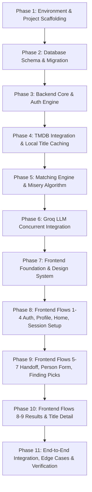

# Movie Recommender — Implementation Plan & To-Do List (v1)

Last updated: September 2026  
Status: Planning Phase  
Target Stack: React + TypeScript (Vite + TSX, port 5173) · Spring Boot 3.x + Maven (Backend, port 8080) · MySQL (`movie_recommender`) · TMDB + Groq APIs  

---

## 1. Executive Summary & Architecture Overview

The system is a group movie and web series recommendation web application designed for friends and family watching on a single shared device (laptop passed around). It gathers individual moods and hard constraints without revealing individual answers, filters candidates out (CBFC certification limits, hard-no genres, language incompatibility, runtime caps), calculates per-person happiness scores (0–100), applies the "average without misery" rule (dropping titles where anyone is < 40, with compromise fallback to 30 and 20), and fetches personalized plain-language explanations for the top 5 picks via Groq LLM.

### Key Architectural Constraints
1. **Monorepo / Two Top-Level Directories:** `/frontend` (React + TypeScript with Vite) and `/backend` (Spring Boot 3.x + Maven).
2. **Client-Server Privacy:** The browser never calls TMDB, OMDb, or Groq directly. All third-party secrets stay on the backend.
3. **Stateless JWT Auth:** Access token (24h) held in frontend memory; sent as `Authorization: Bearer <token>`. Password reset via single-use 30-min token.
4. **Theme & Design System:** Midnight Cinema (`#0E0F13` background, `#1A1C23` surface, `#E5A00D` gold accent, `#F2F2F2` text, Bebas Neue headings, Inter body, accessible 2px gold focus rings).
5. **Deterministic Single-Pass Results:** On session submit, backend performs scoring and invokes Groq concurrently for all 5 recommendations before returning a complete 200 payload (no partial flickering states). Rank 6–10 is lazily computed only if "Show more" is triggered.

---

## 2. Core Implementation Phases

---

## 3. Detailed Phase Breakdown

### Phase 1: Environment & Project Scaffolding
- **Backend Scaffolding:**
  - Create `/backend` using Spring Boot 3.x with Maven (`pom.xml`).
  - Dependencies: `spring-boot-starter-web`, `spring-boot-starter-security`, `spring-boot-starter-data-jpa`, `mysql-connector-j`, `jjwt` (or `nimbus-jose-jwt`), `spring-boot-starter-mail`, `lombok` (optional/standard), `spring-boot-starter-validation`, `spring-boot-starter-webflux` (for WebClient non-blocking calls to Groq/TMDB).
  - Include Maven Wrapper (`mvnw`, `mvnw.cmd`, `.mvn/`) for standalone portability.
  - Setup `application.properties` and `application-local.properties` (gitignored) for:
    - `DB_URL`, `DB_USERNAME`, `DB_PASSWORD`
    - `JWT_SECRET`
    - `TMDB_API_KEY`
    - `OMDB_API_KEY` (optional)
    - `GROQ_API_KEY`
    - `BREVO_SMTP_HOST`, `BREVO_SMTP_PORT`, `BREVO_SMTP_USERNAME`, `BREVO_SMTP_PASSWORD`
  - Configure CORS bean allowing `http://localhost:5173`.
- **Frontend Scaffolding:**
  - Create `/frontend` using Vite + React with TypeScript (`react-ts`).
  - Setup Google Fonts in `index.html`: Bebas Neue & Inter.
  - Setup root `index.css` implementing the CSS Custom Properties design system for **Midnight Cinema**:
    - `--color-bg: #0E0F13`
    - `--color-surface: #1A1C23`
    - `--color-surface-hover: #242731`
    - `--color-accent: #E5A00D`
    - `--color-text: #F2F2F2`
    - `--color-text-muted: #8E8F99`
    - `--color-border: #2D3139`
    - `--color-error: #E5484D`
    - `--color-score-green: #3DD68C` (score >= 70)
    - `--color-score-amber: #F5A524` (40 <= score < 70)
    - Focus visible styles (`outline: 2px solid var(--color-accent)`).

---

### Phase 2: Database Schema & Entity Modelling
- **MySQL Tables & JPA Entities:**
  1. `users`: `id`, `name`, `email` (unique), `password_hash`, `created_at`.
  2. `user_profiles`: `id`, `user_id` (FK unique), `birth_year`, `subtitles_ok`, `languages` (JSON array of strings), `favorite_genres` (JSON array of IDs), `never_want_genres` (JSON array of IDs), `loved_title_ids` (JSON array of IDs), `era_preference` (`ENUM('mostly_newer', 'any_era', 'love_classics')`).
  3. `password_reset_tokens`: `id`, `user_id` (FK), `token` (unique), `expires_at`, `used`, `created_at`.
  4. `genres`: `id`, `tmdb_genre_id`, `name`, `media_type` (`ENUM('movie', 'tv')`), unique(`tmdb_genre_id`, `media_type`).
  5. `keywords`: `id`, `tmdb_keyword_id` (unique), `name`, `is_intensity_marker` (boolean). Pre-populated with:
     - `graphic violence`, `gore`, `sexual violence`, `torture` (`is_intensity_marker = true`)
     - `horror`, `romance` (`is_intensity_marker = false`, for TV mood proxy).
  6. `titles`: `id`, `tmdb_id` (unique), `media_type` (`movie`, `tv`), `title`, `overview`, `poster_path`, `backdrop_path`, `release_date`, `runtime_minutes`, `series_status` (`ongoing`, `ended`), `original_language`, `vote_average`, `vote_count`, `certification_raw`, `certification_band` (`ENUM('U', 'UA7', 'UA13', 'UA16', 'A')` nullable, indexed), `genre_ids` (JSON), `keyword_ids` (JSON), `cast` (JSON top 5), `imdb_rating`, `rotten_tomatoes_rating`, `metacritic_rating`, `cached_at`, `refreshed_at`.
  7. `sessions`: `id`, `user_id` (FK), `media_type` (`movie`, `series`, `either`), `group_size` (1-8), `time_limit` (`under_90`, `90_120`, `2_2.5`, `no_limit`, `episode_or_two`, `binge`, `new_show`), `occasion` (`friends_hangout`, `date_night`, `family_time`, `solo_chill`), `status` (`pending`, `completed`, `failed`), `created_at`.
  8. `session_person_answers`: `id`, `session_id` (FK), `person_index` (0=host), `name` (nullable), `age_band` (`under_7`, `7_12`, `13_15`, `16_17`, `18_plus`), `moods` (JSON 1-2 items), `genres_up_for` (JSON up to 3), `hard_no_genres` (JSON), `languages_ok` (JSON), `intensity` (`light`, `balanced`, `intense`), `something_like_title_id` (FK nullable). Unique on (`session_id`, `person_index`).
  9. `session_results`: `id`, `session_id` (FK), `title_id` (FK), `rank` (1-10), `group_score` (DECIMAL(5,2)), `badge` (`none`, `compromise`, `not_rated`), `ai_explanation` (TEXT), `created_at`. Unique on (`session_id`, `title_id`).
  10. `session_result_person_scores`: `id`, `session_result_id` (FK), `person_index`, `score` (DECIMAL(5,2)).
- **Flyway or SQL Initialization Script:** Create `schema.sql` and `seed-keywords-genres.sql` so the environment boots cleanly without manual SQL tinkering.

---

### Phase 3: Authentication, Security & User Profile
- **Security & JWT Configuration:**
  - Stateless `JwtAuthenticationFilter` reading `Authorization: Bearer <token>`.
  - Whitelist public endpoints: `/auth/**`, `/h2-console/**` (if testing), error endpoints.
  - Standardized error envelope handler returning `{"error": {"code": "...", "message": "..."}}`.
- **Auth Endpoints:**
  - `POST /auth/signup`: Password hash via BCrypt, validation (>8 chars, valid email), immediate JWT issue.
  - `POST /auth/login`: Credential validation, JWT issue.
  - `POST /auth/forgot-password`: Constant generic response message to prevent email enumeration; generates secure 30-min token and sends email via JavaMailSender (with safe console fallback if SMTP credentials not configured).
  - `POST /auth/reset-password`: Token verification (`410 RESET_TOKEN_EXPIRED`, `400 RESET_TOKEN_INVALID`), password update.
- **Profile Endpoints:**
  - `GET /profile`: Returns host profile combined with user name and email.
  - `PUT /profile`: Upserts profile data with validation (max 5 favorite genres, max 5 loved titles, non-empty languages).

---

### Phase 4: TMDB Proxying, Caching & Data Traps Fix
- **TMDB WebClient Service:**
  - Endpoint wrappers:
    - `/genre/movie/list` and `/genre/tv/list` -> populate `genres` table.
    - `/search/keyword` -> resolve and seed marker keywords and series mood proxies.
    - `/search/multi` (or `/search/movie` & `/search/tv`) -> for `POST /titles/search`.
    - `/discover/movie` and `/discover/tv` -> discover candidate pools.
    - `/movie/{id}` and `/tv/{id}` with `append_to_response=release_dates,content_ratings,credits,keywords`.
- **Handling TMDB Data Traps (Forms Spec):**
  1. *Runtime Trap:* TMDB Discover runtime filters are unreliable across localized translations. Save exact runtime in `titles.runtime_minutes` and enforce runtime filters directly in backend SQL / memory.
  2. *Series Age Rating Trap:* Discover TV does not support age rating filters. Fetch content ratings and map to Indian bands or US fallback, storing `certification_band` directly in MySQL.
  3. *Indian Certification Hierarchy & US Fallback:*
     - Indian: `U` -> `U`, `UA 7+` -> `UA7`, `UA 13+` & legacy `UA` -> `UA13`, `UA 16+` -> `UA16`, `A` -> `A`.
     - US Fallback (movies): `G` -> `U`, `PG` -> `UA7`, `PG-13` -> `UA13`, `R`/`NC-17` -> `A`.
     - US Fallback (TV): `TV-Y`/`TV-G` -> `U`, `TV-Y7`/`TV-PG` -> `UA7`, `TV-14` -> `UA16`, `TV-MA` -> `A`.
     - Null if neither -> label as `"Not rated"`.
- **Immediate Caching Rule:** Any search result from `POST /titles/search` is immediately upserted to `titles` with basic fields (tmdb_id, title, poster, release_date).

---

### Phase 5: Matching Engine & Misery Algorithm
- **Candidate Pool Retrieval (Hard Filters via SQL):**
  - Media type filter: `movie`, `tv`, or both if `either`.
  - Age certification filter: `certification_band <= youngestPersonAgeBand` (or unrated).
    - Note: For solo mode (`personIndex = 0`), age band is dynamically computed as `current_year - birth_year`.
  - Language filter: Title's `original_language` must intersect everyone's `languages_ok` set.
  - Hard-no genre filter: Title's `genre_ids` must NOT contain any genre from any person's `hard_no_genres`.
  - Intensity filter (Q7):
    - If anyone picked `light`: title must not contain any of the 4 marker keywords (`without_keywords`).
    - If anyone picked `intense`: title must carry at least one marker keyword (`with_keywords`).
  - Runtime filter:
    - Movies: `runtime_minutes` within selected bracket (`<90`, `90-120`, `120-150`, or `no_limit`).
    - Series: episode runtime & status filter (`episode_or_two`, `binge`, `new_show`).
  - Cache replenishment: If local pool has fewer than 50 candidates, dynamically trigger TMDB Discover with current filters, cache titles, and re-query.
  - On `/sessions/{id}/more`, explicitly exclude `title_id`s already recorded in `session_results`.
- **Per-Person Scoring Function (0–100):**
  - **Genre Match (Weight 35):** Overlap between title genres and person's `genres_up_for` + favorite genres.
  - **Mood Match (Weight 25):** Mood mapped to genres/keywords (via Forms Spec Mood-to-Genre Map).
  - **Light/Intense Match (Weight 15):** Compatibility with person's Q7 slider position.
  - **Similarity Match (Weight 15):** Overlap with TMDB recommendations for person's `something_like_title_id` or profile `loved_title_ids`.
  - **Era Match (Weight 10):** Release year alignment with `era_preference`.
- **Misery Check & Group Aggregation:**
  - Initial misery threshold = 40.
  - For each candidate: check if `min(person_score) >= threshold`.
  - Calculate `group_score = avg(person_scores) + (vote_average * 0.5)` (quality tie-break).
  - If fewer than 5 candidates qualify, retry with threshold = 30; if still < 5, retry with threshold = 20.
  - If threshold was reduced, mark surviving titles with badge `compromise`.
  - If still fewer than 5, return whatever survived with the filter that eliminated the most titles.
- **Top 5 Selection:** Rank top 5 candidates.

---

### Phase 6: Groq LLM Explanation Engine
- **Parallel Prompt Execution:**
  - For each of the top 5 titles, construct a tailored prompt containing:
    - Title name and release year.
    - Genres and plot summary snippet.
    - Group occasion (S4).
    - Top matching people, their chosen moods, and individual score highlights.
  - Format requirement: friendly 2-line reason explaining why it fits the group.
  - Use `CompletableFuture` / WebClient to dispatch all 5 requests concurrently to Groq API (`llama-3.3-70b-versatile` or configured model).
  - Fallback resilience: If Groq fails or times out, degrade gracefully to a clean programmatic one-liner (e.g., *"A thrilling comedy matching Rahul's mood and Amey's favorite genres."*) without failing the session (`502 GROQ_UNREACHABLE` code in fallback or soft degradation).
- **Session Results Persistence:**
  - Insert rows into `session_results` (rank 1–5 or 6–10).
  - Insert individual scores into `session_result_person_scores`.
  - Return the finalized 200 payload matching API Contracts.

---

### Phase 7: Frontend Design System & Common UI
- **Design Tokens & Typography:**
  - Bebas Neue for titles and headers (`font-family: 'Bebas Neue', sans-serif`).
  - Inter for body, labels, buttons (`font-family: 'Inter', sans-serif`).
  - Max container width: 1200px (desktop centered), forms at 720px column.
- **Reusable Component Library (`/frontend/src/components`):**
  1. `Button`: Primary (gold `#E5A00D`), Secondary (outline), with disabled states and loading spinner.
  2. `Chip`: Selectable chip with gold checkmark, keyboard toggleable with Space.
  3. `TextInput`: Dark surface, gold ring on focus, inline red error message below.
  4. `Stepper`: `[ - ] count [ + ]` for group size (1 to 8).
  5. `Slider3Step`: 3-stop slider for Q7 (Light, Balanced, Intense).
  6. `TitleSearchPicker`: Debounced async search calling `POST /titles/search` with poster previews.
  7. `PersonScoreCircles`: Initials of viewers, color-coded (`#3DD68C` green for 70+, `#F5A524` amber for 40–69).
  8. `LoadingSpinner`: Film-reel animated spinner.
  9. `Navbar`: App title, user display name dropdown, Edit profile, Log out.

---

### Phase 8: Frontend Screen Implementation (Screens 1 to 4)
- **Screen 1: Sign up / Log in / Forgot Password (`/login`, `/signup`, `/forgot-password`, `/reset-password`):**
  - Split screen: blurred poster backdrop + title on left; tabbed card on right.
  - Form validation: email format, 8+ char password, confirm password match.
  - Forgot password sub-flow with generic confirmation notice and token reset page.
- **Screen 2: Profile Setup Wizard (`/profile/setup`):**
  - 3-step wizard with progress line:
    - Step 1: About You (pre-filled display name, birth year dropdown P2).
    - Step 2: Languages (P4 chips + search, P5 subtitles toggle).
    - Step 3: Taste (P6 favorite genres up to 5, P7 hard-no genres, P8 loved titles search picker up to 5 optional, P9 era 3-way toggle).
  - Back / Next navigation with state preservation.
- **Screen 3: Home (`/`):**
  - Greeting ("Hi [Name]"), prominent gold "Find something to watch" CTA.
  - Profile summary card with quick "Edit" link.
  - Top navigation with dropdown.
- **Screen 4: Session Setup (`/session/new`):**
  - S1: 3 cards for media type (Movie, Series, Either).
  - S2: Stepper (1 to 8).
  - S3: Dynamic time chips (S3a movie runtimes vs S3b series duration/binge).
  - S4: Occasion chips (Friends hangout, Date night, Family time, Solo chill).
  - "Start" transitions to Handoff (group) or directly to Person's form (solo).

---

### Phase 9: Frontend Screen Implementation (Screens 5 to 7)
- **Screen 5: Handoff Screen (`/session/:id/handoff`):**
  - Full-screen dark focus mode: "Pass the laptop to person X of N".
  - Numbered progress dots showing completed vs upcoming.
  - Gold "I'm ready" button (triggers on Enter).
  - "Go back" link to allow previous person to edit their submission.
- **Screen 6: Person's Form (`/session/:id/person/:index`):**
  - Order: Host goes first (`personIndex = 0`), pre-filled with profile answers.
  - Solo mode: Automatically skips Q1 (Name) and Q2 (Age Band).
  - Questions Q1 to Q8 with clear constraints (mood max 2 chips, genres max 3 chips, Q7 3-step slider, Q8 title search picker + Skip).
  - Client validation: Scrolls to first invalid input on submit with red highlight.
  - Answers hidden upon submission; held in client session state until last viewer finishes.
- **Screen 7: Finding Picks (`/session/:id/loading`):**
  - Dispatches `POST /sessions/{id}/submit` with the aggregated answers.
  - Displays film-reel spinner and "Matching N people's answers...".
  - If >10s: adds "Still working...".
  - Error state with Retry button if server/TMDB unreachable.
  - Zero results state: "Nothing fits everyone tonight", identifying the most restrictive filter with a loosen CTA.

---

### Phase 10: Frontend Screen Implementation (Screens 8 to 9)
- **Screen 8: Results: Top 5 (`/session/:id/results`):**
  - Header: Session summary and attendees list ("Top 5 for Amey, Rahul + 1").
  - 5 recommendation cards rendered in a unified row:
    - Poster image, Title, Year, Runtime, Certificate.
    - Group match percentage in gold.
    - Individual score circles with attendee initials.
    - 2-line AI generated explanation from Groq.
    - Badges: `Compromise pick` or `Not rated`.
  - "Show more" button: calls `POST /sessions/{id}/more` and appends ranks 6–10 as a second row.
  - "Change answers" and "Start over" actions.
- **Screen 9: Title Detail Modal / Page (`/session/:id/title/:titleId`):**
  - Wide backdrop banner, poster, metadata overview, top 5 cast with headshots.
  - "Why this pick" highlight box: Full AI explanation + breakdown per attendee ("Rahul: matches Thrill and Hindi").
  - Keyboard navigation: Esc to close / return to results.

---

### Phase 11: End-to-End Testing, Polish & Verification
- **Test Scenarios:**
  1. *Solo Flow:* Sign up -> complete profile -> solo session -> verify Q1/Q2 skipped -> 5 results with AI reasoning.
  2. *Group Flow (3 people):* Host + 2 guests with conflicting genres and one minor (e.g. 13-year-old) -> verify 18+ titles are hard-filtered out, hard-no genres respected, misery threshold applied.
  3. *Compromise Flow:* Highly restrictive constraints forcing misery threshold to 30 or 20 -> verify "Compromise pick" badge appears.
  4. *Show More Flow:* Verify rank 6–10 loads seamlessly without re-scoring existing titles.
  5. *Keyboard Navigation:* Verify full walkthrough using Tab, Enter, Space, and Arrow keys.
  6. *Offline / API Fault Injection:* Verify friendly fallback error messages when TMDB or Groq is unreachable.

---

## 4. Execution Tracking & To-Do List

The complete, granular checklist for tracking execution progress across all 11 phases is maintained in:

👉 **[Plan/to-do.md](./to-do.md)**

