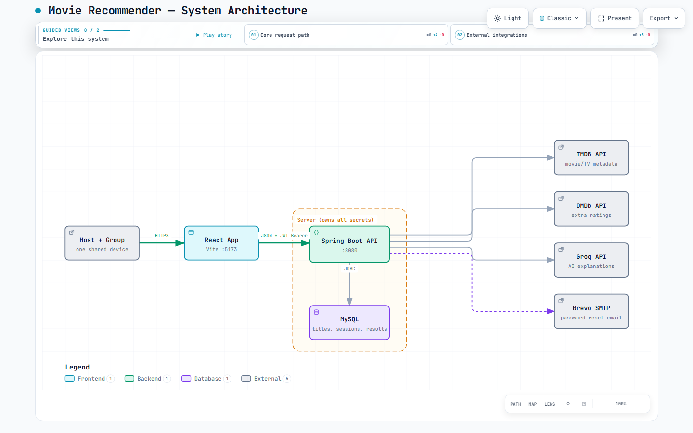
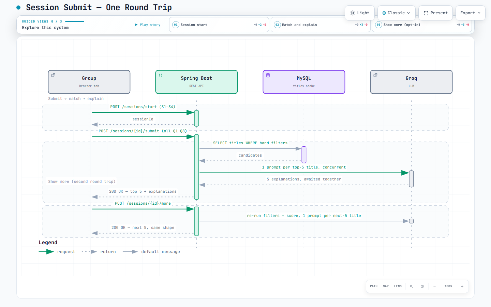
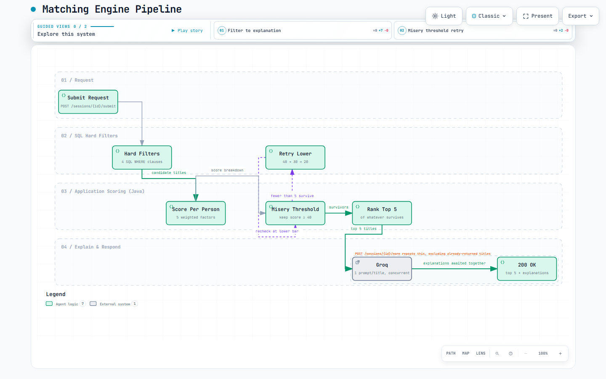
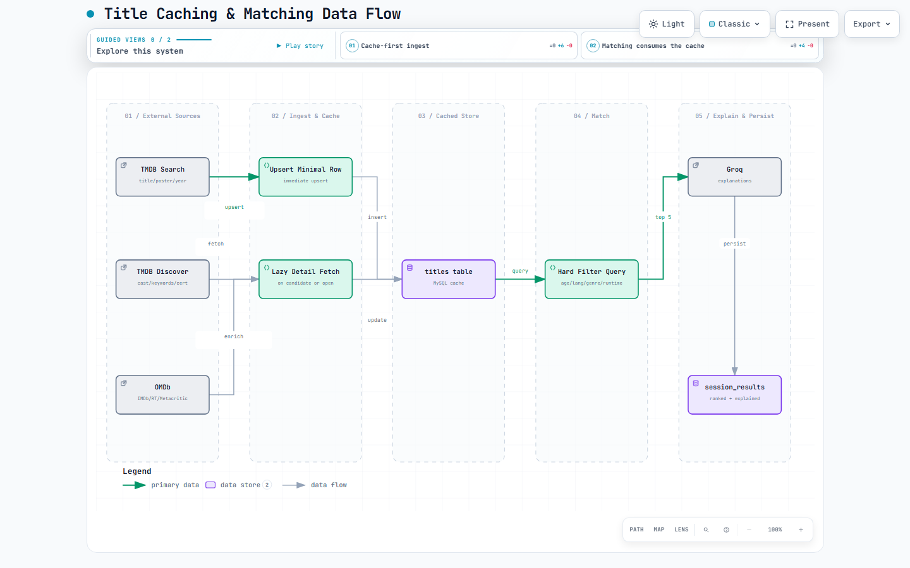
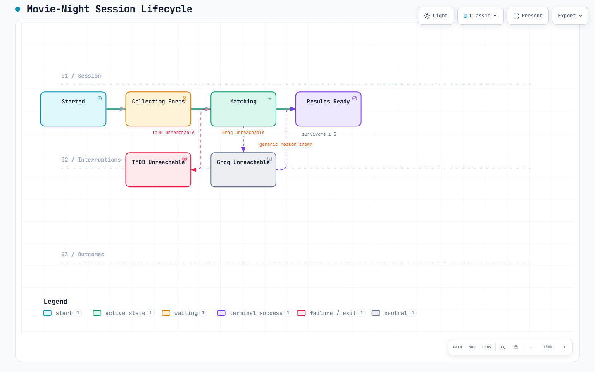

# Architecture Diagrams

Five diagrams covering the Movie Recommender's system design, generated from the facts in [`../docs/trd.md`](../docs/trd.md) (the TRD is the source of truth — if it changes, these should be regenerated to match). Each diagram ships as a standalone, interactive HTML file with pan/zoom, theme toggle, search, and guided views; the screenshots below are static previews of the same file.

## Contents

| # | Diagram | Type | File |
|---|---------|------|------|
| 1 | [System Architecture](#1-system-architecture) | architecture | [`architecture.html`](./architecture.html) |
| 2 | [Session Submit Sequence](#2-session-submit-sequence) | sequence | [`sequence.html`](./sequence.html) |
| 3 | [Matching Engine Workflow](#3-matching-engine-workflow) | workflow | [`workflow.html`](./workflow.html) |
| 4 | [Title Caching Data Flow](#4-title-caching-data-flow) | dataflow | [`dataflow.html`](./dataflow.html) |
| 5 | [Session Lifecycle](#5-session-lifecycle) | lifecycle | [`lifecycle.html`](./lifecycle.html) |

---

### 1. System Architecture



React frontend → Spring Boot API → MySQL, with TMDB, OMDb, Groq, and Brevo SMTP proxied behind the backend so no API key ever reaches the browser. Mirrors the architecture diagram in the TRD's [Architecture overview](../docs/trd.md#architecture-overview).

**File:** [`architecture.html`](./architecture.html) · **Spec:** [`architecture.json`](./architecture.json)

### 2. Session Submit Sequence



The core request flow: `POST /sessions/start`, the client-side handoff loop, then `POST /sessions/{id}/submit` — one round trip that runs hard SQL filters, per-person scoring with the misery-threshold retry, and concurrent Groq calls before a single response. Also covers the opt-in `POST /sessions/{id}/more` round trip. See the TRD's [Request flow: a full session](../docs/trd.md#request-flow-a-full-session).

**File:** [`sequence.html`](./sequence.html) · **Spec:** [`sequence.json`](./sequence.json)

### 3. Matching Engine Workflow



The pipeline behind a single submit: SQL hard filters → per-person scoring (genre 35 / mood 25 / light-intense 15 / similarity 15 / era 10) → misery threshold with retry at 30 then 20 → top-5 selection → Groq explanations. See the TRD's [Matching engine](../docs/trd.md#matching-engine).

**File:** [`workflow.html`](./workflow.html) · **Spec:** [`workflow.json`](./workflow.json)

### 4. Title Caching Data Flow



How TMDB/OMDb data gets into the `titles` cache and back out to the matching engine: an immediate minimal upsert on search, a lazy full-detail fetch only when a title becomes a match candidate or its detail page opens, and OMDb enrichment cached once per title. See the TRD's [External integrations](../docs/trd.md#external-integrations).

**File:** [`dataflow.html`](./dataflow.html) · **Spec:** [`dataflow.json`](./dataflow.json)

### 5. Session Lifecycle



A session's states from `started` through `matching` to `results_ready`, plus the two documented exception paths: TMDB unreachable (hard failure, 502) and Groq unreachable (degraded but not failed — results still return with a generic reason). See the TRD's [Error handling](../docs/trd.md#error-handling).

**File:** [`lifecycle.html`](./lifecycle.html) · **Spec:** [`lifecycle.json`](./lifecycle.json)

---

## How to view

Each `.html` file is fully self-contained — open it directly in any browser, no server or build step needed. Every diagram supports:

- **Pan/zoom** and **search** over nodes and labels
- **Theme toggle** (light/dark)
- **Guided views** — a curated set of "chapters" that focus and annotate a subset of the diagram (e.g. sequence.html has "Session start", "Match and explain", "Show more")
- **Relationship tracing** — click a node to highlight its connections

## Folder structure

```
diagrams/
├── README.md                          this file
├── <name>.json                        diagram specification (input)
├── <name>.html                        rendered interactive diagram (the deliverable)
└── <name>.visual-check.*              browser-evidence screenshots + receipt (build artifacts, see below)
```

`<name>` is one of `architecture`, `sequence`, `workflow`, `dataflow`, `lifecycle`.

## Regenerating a diagram

These were built with the [Archify](https://skills.sh/tt-a1i/archify) skill. To edit one, change its `.json` spec and re-run:

```bash
node bin/archify.mjs validate <type> diagrams/<name>.json --quality showcase --json
node bin/archify.mjs deliver  <type> diagrams/<name>.json diagrams/<name>.html --quality showcase --json
node bin/archify.mjs visual-check diagrams/<name>.html --json
```

`validate` checks composition (label collisions, crossings, readability); `deliver` freezes the checked spec into the `.html`; `visual-check` captures real-browser screenshots (the `.visual-check.*` files) as evidence the page renders and fits without scrolling at common desktop sizes.

## Notes and known tradeoffs

- Diagrams are deliberately sparse (short labels, no descriptive "cards" panel) so each fits on a single 1440×900 screen without vertical scrolling — a hard constraint of the authoring contract these were built under.
- Content is grounded in `docs/trd.md` as of the date these were generated (27 Sep 2026). If the TRD changes — new endpoints, a different scoring formula, additional external integrations — these diagrams will drift and should be regenerated rather than trusted blindly.
- The `lifecycle.html` diagram folds "nothing fits" (fewer than 5 survivors even at the lowest misery threshold) into the `Results Ready` state's sublabel rather than giving it a separate node, to keep the diagram within the single-lane layout that fits the page-size constraint.
