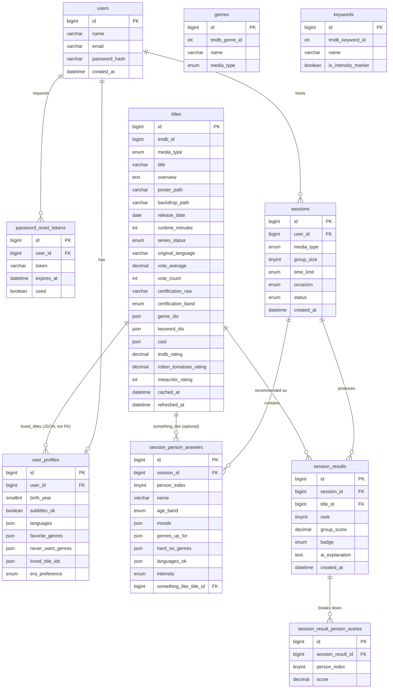

# Movie Recommender — Database Schema (ERD)

Last updated: 27 Sep 2026 · Related docs: [PRD](./prd.md) · [UI/UX Spec](./ui-ux-spec.md) · [Forms Spec](./forms-spec.md) · [Wireframes](./wireframes.md) · [TRD](./trd.md) · [API Contracts](./api-contracts.md)

## Approach

Three decisions shape every table below:

1. **Multi-value data (a person's moods, genres, languages; a title's genres and cast) is stored in MySQL `JSON` columns**, not junction tables. Fewer tables, simpler code; the cost is no database-enforced referential integrity on the values inside — the application is responsible for only ever writing valid genre IDs, language codes, etc. See the [JSON column reference](#json-column-reference) below for exactly what each one holds.
2. **Every primary key is an auto-increment `BIGINT`.**
3. **Session data (`sessions`, `session_person_answers`, `session_results`) is kept permanently.** No expiry or cleanup job in v1; this data is free groundwork for later features (a "past sessions" list, or training better weights from real usage).

One exception to the JSON-everywhere rule: a title's **age-certification band** is stored as a plain, indexed column (not derived from JSON at query time), because it's checked on every single matching request and needs to be fast. That reasoning is explained where it appears.

## ER diagram

Only real foreign-key relationships are drawn. `genres` and `keywords` are lookup tables referenced *by ID* from several JSON columns (a title's genres/keywords, a person's genre/mood answers) — those references aren't drawn as lines here because MySQL doesn't enforce them as foreign keys.

## Tables (v1)

### `users`

Auth only — no preference data lives here, matching the `/auth/**` vs `/profile` split in the TRD.

| Column | Type | Notes |
| --- | --- | --- |
| `id` | `BIGINT` PK, auto-increment | |
| `name` | `VARCHAR(100)` | |
| `email` | `VARCHAR(255)` UNIQUE | |
| `password_hash` | `VARCHAR(255)` | bcrypt |
| `created_at` | `DATETIME` | |

### `user_profiles`

One row per user, created right after sign-up (Forms Spec P1–P9). 1-to-1 with `users`.

| Column | Type | Notes |
| --- | --- | --- |
| `id` | `BIGINT` PK, auto-increment | |
| `user_id` | `BIGINT` FK → `users.id`, UNIQUE | |
| `birth_year` | `SMALLINT` | P2 |
| `subtitles_ok` | `BOOLEAN` | P5 |
| `languages` | `JSON` | P4 — array of ISO 639-1 codes |
| `favorite_genres` | `JSON` | P6 — array of `genres.id`, max 5 (app-enforced) |
| `never_want_genres` | `JSON` | P7 — array of `genres.id` |
| `loved_title_ids` | `JSON` | P8 — array of `titles.id`, optional, up to 5 (app-enforced) |
| `era_preference` | `ENUM('mostly_newer','any_era','love_classics')` | P9 |

There is no `country` column — the app is India-only, so it's not stored per user (per the Forms Spec).

### `password_reset_tokens`

| Column | Type | Notes |
| --- | --- | --- |
| `id` | `BIGINT` PK, auto-increment | |
| `user_id` | `BIGINT` FK → `users.id` | |
| `token` | `VARCHAR(255)` UNIQUE | |
| `expires_at` | `DATETIME` | 30 minutes from creation |
| `used` | `BOOLEAN` DEFAULT `false` | |
| `created_at` | `DATETIME` | |

### `genres`

A lookup table, populated once from TMDB's genre-list endpoints and refreshed rarely. Referenced *by ID* from JSON columns elsewhere — not a foreign key relationship.

| Column | Type | Notes |
| --- | --- | --- |
| `id` | `BIGINT` PK, auto-increment | |
| `tmdb_genre_id` | `INT` | TMDB's own ID |
| `name` | `VARCHAR(50)` | e.g. "Comedy" |
| `media_type` | `ENUM('movie','tv')` | TMDB's movie and TV genre lists differ |

Unique on (`tmdb_genre_id`, `media_type`).

### `keywords`

Another lookup table, resolved on demand (not split by media type — a TMDB keyword ID is the same whether it's applied to a movie or a series). Two uses: the literal "horror" / "romance" keywords for the series mood proxies, and the four **intensity marker** keywords (`graphic violence`, `gore`, `sexual violence`, `torture`) that power Q7's light/intense filter — see the Forms Spec's [Keyword resolution](./forms-spec.md#keyword-resolution) section for why these specific ones.

| Column | Type | Notes |
| --- | --- | --- |
| `id` | `BIGINT` PK, auto-increment | |
| `tmdb_keyword_id` | `INT` UNIQUE | resolved once via TMDB's keyword-search endpoint |
| `name` | `VARCHAR(50)` | e.g. "graphic violence" |
| `is_intensity_marker` | `BOOLEAN` DEFAULT `false` | flags the 4 keywords used for Q7; kept as data, not a code constant, so it's inspectable/editable without redeploying |

### `titles`

Cached TMDB (+ optional OMDb) data — the two data traps from the Forms Spec are why this table exists at all, instead of calling TMDB live on every request.

| Column | Type | Notes |
| --- | --- | --- |
| `id` | `BIGINT` PK, auto-increment | |
| `tmdb_id` | `BIGINT` UNIQUE | |
| `media_type` | `ENUM('movie','tv')` | |
| `title` | `VARCHAR(255)` | |
| `overview` | `TEXT` | |
| `poster_path` | `VARCHAR(255)` | |
| `backdrop_path` | `VARCHAR(255)` | |
| `release_date` | `DATE` | movie release or series first-air date |
| `runtime_minutes` | `INT` | movie runtime, or a series' typical episode length |
| `series_status` | `ENUM('ongoing','ended')` | series only, null for movies — feeds S3b |
| `original_language` | `VARCHAR(10)` | ISO 639-1 |
| `vote_average` | `DECIMAL(3,1)` | TMDB rating, for the quality floor and tie-breaks |
| `vote_count` | `INT` | |
| `certification_raw` | `VARCHAR(20)` | as shown to the user, e.g. "UA 13+", "Not rated" |
| `certification_band` | `ENUM('U','UA7','UA13','UA16','A')` NULLABLE | **plain column, not JSON** — every matching request filters by "at or under the youngest person's band", so this needs a normal indexed comparison, not a JSON function. Null = no rating found anywhere (shown as "Not rated") |
| `genre_ids` | `JSON` | array of `genres.id` |
| `keyword_ids` | `JSON` | array of `keywords.id`, fetched alongside a title's other details when first cached — this is what lets Q7 and the horror/romance mood proxies run as a local SQL check instead of a fresh TMDB call every time |
| `cast` | `JSON` | array of `{name, character, photo_url}`, top 5 only — no feature needs to search "titles with actor X" in v1, so a normalized `people`/`title_cast` pair isn't worth the extra tables yet |
| `imdb_rating` | `DECIMAL(3,1)` NULLABLE | from OMDb |
| `rotten_tomatoes_rating` | `TINYINT` NULLABLE | from OMDb, percentage |
| `metacritic_rating` | `TINYINT` NULLABLE | from OMDb |
| `cached_at` | `DATETIME` | first fetched |
| `refreshed_at` | `DATETIME` | last re-checked (exact refresh cadence is a build-time call, per the TRD) |

### `sessions`

One row per "who's watching tonight" (Forms Spec S1–S4).

| Column | Type | Notes |
| --- | --- | --- |
| `id` | `BIGINT` PK, auto-increment | |
| `user_id` | `BIGINT` FK → `users.id` | the host |
| `media_type` | `ENUM('movie','series','either')` | S1 |
| `group_size` | `TINYINT` | S2, 1–8 |
| `time_limit` | `ENUM('under_90','90_120','2_2.5','no_limit','episode_or_two','binge','new_show')` | S3a/S3b — one enum covering both, since only one applies per `media_type` |
| `occasion` | `ENUM('friends_hangout','date_night','family_time','solo_chill')` NULLABLE | S4, optional |
| `status` | `ENUM('pending','completed','failed')` | |
| `created_at` | `DATETIME` | |

### `session_person_answers`

One row per person, per session (Forms Spec Q1–Q8).

| Column | Type | Notes |
| --- | --- | --- |
| `id` | `BIGINT` PK, auto-increment | |
| `session_id` | `BIGINT` FK → `sessions.id` | |
| `person_index` | `TINYINT` | order in the group (0 = host, who goes first) |
| `name` | `VARCHAR(100)` NULLABLE | Q1, null when watching alone |
| `age_band` | `ENUM('under_7','7_12','13_15','16_17','18_plus')` NULLABLE | Q2, null when watching alone (age comes from the profile instead) |
| `moods` | `JSON` | Q3, array of mood strings, 1–2 (app-enforced) |
| `genres_up_for` | `JSON` | Q4, array of `genres.id`, up to 3 |
| `hard_no_genres` | `JSON` | Q5, array of `genres.id` |
| `languages_ok` | `JSON` | Q6, array of ISO 639-1 codes |
| `intensity` | `ENUM('light','balanced','intense')` | Q7 |
| `something_like_title_id` | `BIGINT` FK → `titles.id`, NULLABLE | Q8, optional |

Unique on (`session_id`, `person_index`).

### `session_results`

The results for a session, with the score and explanation already computed — not recalculated on every view. Rows are added **incrementally**: rank 1–5 are written when the session is first submitted; rank 6–10 are only computed and written if the group clicks "Show more" (see the TRD's [Request flow](./trd.md#request-flow-a-full-session)). A session that never gets a "Show more" click simply never has rows past rank 5.

| Column | Type | Notes |
| --- | --- | --- |
| `id` | `BIGINT` PK, auto-increment | |
| `session_id` | `BIGINT` FK → `sessions.id` | |
| `title_id` | `BIGINT` FK → `titles.id` | |
| `rank` | `TINYINT` | 1–10 |
| `group_score` | `DECIMAL(5,2)` | the "average without misery" result |
| `badge` | `ENUM('none','compromise','not_rated')` | |
| `ai_explanation` | `TEXT` | Groq's output for this title |
| `created_at` | `DATETIME` | |

Unique on (`session_id`, `title_id`).

### `session_result_person_scores`

The per-person breakdown behind each result card's colored circles (green 70+, amber 40–69).

| Column | Type | Notes |
| --- | --- | --- |
| `id` | `BIGINT` PK, auto-increment | |
| `session_result_id` | `BIGINT` FK → `session_results.id` | |
| `person_index` | `TINYINT` | matches a `session_person_answers.person_index` in the same session |
| `score` | `DECIMAL(5,2)` | 0–100, this person's individual score for this title |

## JSON column reference

What each JSON column actually holds, so the shape is obvious at a glance:

| Column | Example value |
| --- | --- |
| `user_profiles.languages` | `["hi", "en"]` |
| `user_profiles.favorite_genres` | `[35, 80]` |
| `user_profiles.loved_title_ids` | `[104, 512, 998]` |
| `titles.genre_ids` | `[35, 18]` |
| `titles.keyword_ids` | `[412, 890]` |
| `titles.cast` | `[{"name": "Actor A", "character": "Lead", "photo_url": "..."}]` |
| `session_person_answers.moods` | `["Laugh", "Thrill"]` |
| `session_person_answers.genres_up_for` | `[35, 28, 53]` |
| `session_person_answers.languages_ok` | `["hi", "en"]` |

## Indexing notes

- `certification_band`, `original_language`, `runtime_minutes`, `series_status`, `vote_average`, and `vote_count` are plain columns with normal indexes — these are checked on every matching request and need to stay fast.
- Genre filtering (`titles.genre_ids` against a person's `genres_up_for` or `hard_no_genres`) uses `JSON_OVERLAPS()`, which can't use a normal index. If this becomes slow once there's real data volume, MySQL supports a **generated column + index** as a fix (e.g. a virtual column per common genre, or a multi-valued index on `genre_ids`) — not needed to design now, just worth knowing the escape hatch exists.
- The same applies to `titles.keyword_ids` (Q7's intensity check, and the horror/romance mood proxies): `JSON_OVERLAPS()` or `JSON_CONTAINS()` against the resolved marker keyword IDs, same escape hatch if it's ever needed.
- Language filtering works the same way, via `JSON_OVERLAPS()` on `languages_ok` / `languages`.

## Later versions (rough)

| Version | Schema changes |
| --- | --- |
| v2 | New `members` table (per-user saved people: `name`, `birth_year`); `session_person_answers` gains a nullable `member_id` FK, used instead of raw `name`/`age_band` once a member is picked. New `watched` table (`user_id` or `member_id`, `title_id`, `watched_at`) |
| v3 | New `ratings` table (`member_id`, `title_id`, `stars` 1–5, `rated_at`) |
| v4 | `session_person_answers` gains a nullable `mood_text` column; new `session_refinements` table (`session_id`, `instruction_text`, `created_at`) for chat-based re-ranking |
| v5 | `users` gains a nullable `google_id`; `password_hash` becomes nullable (Google-only accounts) |
| v6 | `titles` gains `watch_providers` (`JSON`) and `trailer_key` (`VARCHAR`) — no new tables |

## Open questions

None right now.
