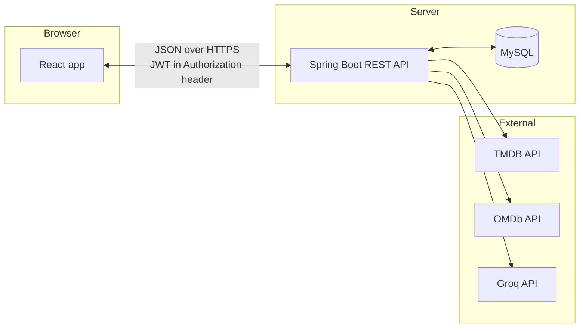
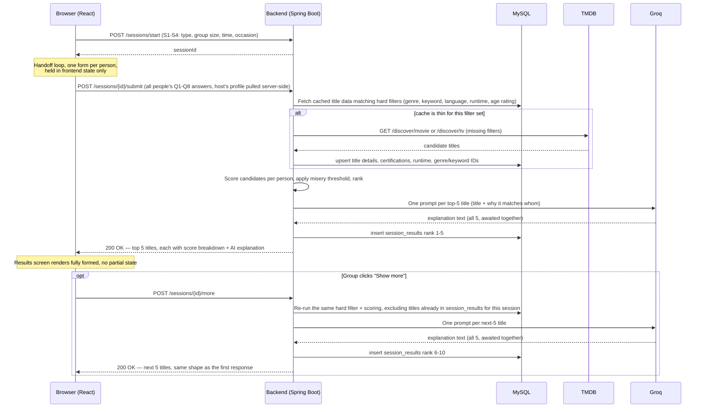

# Movie Recommender — TRD

Last updated: 27 Sep 2026 · Related docs: [PRD](./prd.md) · [UI/UX Spec](./ui-ux-spec.md) · [Forms Spec](./forms-spec.md) · [Wireframes](./wireframes.md) · [Database Schema](./database-schema.md) · [API Contracts](./api-contracts.md)

This document answers "how will it work?" — the pieces, how they talk to each other, and the contracts between frontend and backend. Table-level schema (columns, keys, relationships) lives in a separate Database Schema / ERD doc.

## Scope

v1 only: email/password auth with password reset, one-time profile, session setup, per-person forms, group-fair matching, top 5 results with AI explanations, title detail. Later-version hooks (saved members, ratings, mood chat, Google sign-in, where-to-watch) are noted where they'll plug in, but not designed in detail here.

## Stack

| Layer | Choice |
| --- | --- |
| Frontend | React (desktop web, no fixed pixel widths) |
| Backend | Spring Boot (REST API) |
| Database | MySQL |
| Movie/TV metadata | TMDB API (primary); OMDb as an optional secondary source for extra ratings |
| AI explanations | Groq (open-source LLM) |
| Auth | Email + password, JWT-based |

## Project setup

- **One repository**, two top-level folders: `/frontend` (React) and `/backend` (Spring Boot). Simple to clone and demo as a single project, which fits a solo build.
- **Local ports:** frontend dev server on `5173`, backend on `8080`. The backend allows CORS from the frontend's dev origin.
- **Environment variables** (never committed — read at runtime, e.g. from a local `.env` / `application-local.properties` that's gitignored):

  | Variable | Purpose |
  | --- | --- |
  | `DB_URL`, `DB_USERNAME`, `DB_PASSWORD` | MySQL connection |
  | `JWT_SECRET` | signs and verifies access tokens |
  | `TMDB_API_KEY` | TMDB calls |
  | `OMDB_API_KEY` | OMDb calls (optional integration) |
  | `GROQ_API_KEY` | Groq calls |
  | `BREVO_SMTP_HOST`, `BREVO_SMTP_USERNAME`, `BREVO_SMTP_PASSWORD` | password-reset email |

## Architecture overview

The frontend never talks to TMDB, OMDb, or Groq directly — every external call is proxied through the backend, so API keys stay server-side and never reach the browser.



## Authentication

JWT, stateless.

1. **Sign up / Log in** → backend verifies credentials (password hashed with bcrypt), issues a signed JWT (short-lived access token, e.g. 24h) containing the user id.
2. **Frontend** stores the token in memory (not localStorage, to reduce XSS exposure) and sends it as `Authorization: Bearer <token>` on every request after login.
3. **Password reset:** a separate, single-use, short-lived token (30 min expiry) emailed as a link; unrelated to the JWT used for normal sessions.
4. **Protected routes:** a Spring Security filter validates the JWT on every request except `/auth/**`.

No server-side session state to manage; this also means the API can scale to more than one instance later without sticky sessions, though that's not a v1 concern.

## Request flow: a full session

This is the core flow the rest of the document supports. Everything happens without leaving the browser tab; the backend does one round of work per session, not per person.



The **"Finding picks"** loading screen (UI/UX Spec, screen 7) spans the whole of steps 3 onward: one request, one wait, one response. There is no polling, streaming, or WebSocket in v1 — simpler to build and debug, at the cost of a single longer wait (typically the 5 Groq calls, which can run in parallel server-side to keep this under a few seconds). "Show more" is a deliberately separate, second round-trip: nothing beyond the first 5 is computed unless the group actually asks for it, so a session that never clicks "Show more" never pays for the extra scoring or the extra 5 Groq calls.

## API endpoints (v1)

| Method & path | Purpose | Auth |
| --- | --- | --- |
| `POST /auth/signup` | Create account | No |
| `POST /auth/login` | Returns JWT | No |
| `POST /auth/forgot-password` | Sends reset email | No |
| `POST /auth/reset-password` | Consumes reset token, sets new password | No (token in body) |
| `GET /profile` | Current user's profile (P1–P9) | Yes |
| `PUT /profile` | Create/update profile | Yes |
| `GET /genres` | Genre list (movie + series), cached from TMDB | Yes |
| `POST /titles/search` | Search TMDB by title (used in P8, Q8 pickers) | Yes |
| `POST /sessions/start` | Submit S1–S4, returns a `sessionId` | Yes |
| `POST /sessions/{id}/submit` | Submit every person's Q1–Q8 answers; triggers matching + Groq for rank 1–5 | Yes |
| `POST /sessions/{id}/more` | Compute and return rank 6–10, excluding titles already in this session's results; triggers matching + Groq again, only for the next 5 | Yes |
| `GET /sessions/{id}/results` | Re-fetch the same session's results so far (e.g. after a refresh) | Yes |
| `GET /titles/{id}` | Full title detail (for screen 9) | Yes |

`sessionId` is a short-lived server-side record (candidate answers + computed results), not tied to watch history — that arrives in v2.

## Matching engine

Implements the rules from the [Forms Spec](./forms-spec.md#how-answers-combine-for-a-group) exactly:

1. **Hard filters** run as SQL `WHERE` clauses against the locally cached title table (age rating ≤ youngest person's band, language intersects everyone's allowed set, genre not in anyone's hard-no list, keyword-based Q7 check, runtime within the group's time limit). On `/sessions/{id}/more`, this step also excludes any `title_id` already present in `session_results` for that session.
2. **Per-person scoring** (genre 35 / mood 25 / light-intense 15 / similarity 15 / era 10) runs in the application layer, not SQL — the weights are expected to change after testing, so they're a plain Java function, not baked into a query.
3. **Misery threshold** (drop below 40, retry at 30 then 20) is a loop in that same function.
4. **Top 5 of whatever's left** go to the Groq step for that request — 5 on the initial submit, 5 more if "Show more" is clicked. Nothing beyond what's actually been requested is scored or explained; there's no upfront computation of a full top-10.

This keeps the scoring logic testable in isolation (unit tests can call it with fixed inputs and check the ranking), separate from the SQL that narrows the candidate pool.

## External integrations

### TMDB

- All calls go through the backend using a server-held API key (never sent to the browser).
- **Caching:** per the Forms Spec's two data traps, title details (runtime, certifications, genre and keyword IDs) are fetched once per title and stored in MySQL, then reused. A scheduled or on-demand refresh job re-checks stale entries (exact cadence is a build-time decision, not fixed here).
- **`/titles/search` caches immediately.** Any title a search returns (used by P8 and Q8's pickers) is upserted into `titles` right away with whatever minimal fields TMDB's search response includes (title, poster, year), so it can be referenced by ID (`loved_title_ids`, `something_like_title_id`) the moment it's picked. The fuller detail fetch (cast, keywords, certification) happens lazily — either when that title becomes an actual match candidate, or when its detail page is opened.
- **Certifications:** Indian certificate first; if TMDB has none, the stored US rating is mapped per the Forms Spec's fallback table; if neither exists, the title is stored with a `certification: null` and the frontend shows "Not rated". **Solo mode** derives an age band from the profile's `birth_year` at request time — see the Forms Spec's solo-mode note — rather than storing a band directly on the profile.
- **Keywords:** resolved and cached the same way genres are — see the Forms Spec's [Keyword resolution](./forms-spec.md#keyword-resolution) and the Database Schema's `keywords` table for the specific keywords used and why.

### OMDb (optional, secondary)

- Used only to enrich a title with IMDb/Rotten Tomatoes/Metacritic scores where available.
- Called at the same time a title is first cached from TMDB, not on every request, since OMDb's free tier has a low daily call limit.

### Groq

- One prompt per top-5 title, built from: title, genres, the group's shared context (occasion, S4), and which person(s) it best matches (from the per-person score breakdown).
- Calls for the 5 titles run concurrently (not one after another) to keep the combined wait short, since the backend now waits for all of them before responding.
- **Prompt shape (illustrative, tuned during build):**

  ```
  You are recommending "{title}" ({genres}) to a group watching for {occasion}.
  It scored well for: {names and their matched moods/genres}.
  Write a friendly 2-line reason this fits the group.
  ```

### Password-reset email

Needed to actually deliver the "Check your inbox" link (UI/UX Spec, screen 1). **Brevo's free tier** is the recommended choice: 300 emails/day forever, no credit card, and a plain SMTP relay that plugs directly into Spring Boot's built-in `JavaMailSender` — no custom SDK integration needed, just SMTP host/port/credentials as environment variables ([Brevo free SMTP](https://www.brevo.com/free-smtp-server/)). Resend (3,000/month free) is a reasonable alternative if Brevo's daily cap ever becomes a problem for testing.

## Error handling

Every error response uses the same envelope, so the frontend has one place to parse errors instead of guessing per endpoint:

```json
{
  "error": {
    "code": "TMDB_UNREACHABLE",
    "message": "Couldn't reach the movie database"
  }
}
```

Matches the states already defined in the UI/UX Spec (screens 7–8), implemented as standard HTTP status codes the frontend maps to those messages:

| Situation | Status | `error.code` | Frontend shows |
| --- | --- | --- | --- |
| TMDB unreachable | `502` | `TMDB_UNREACHABLE` | "Couldn't reach the movie database" + Retry |
| Groq unreachable | `502` (matching still completes; explanations fall back to a generic one-liner rather than failing the whole request) | `GROQ_UNREACHABLE` | Results still show, with a plainer reason |
| Fewer than 5 titles survive even at the lowest misery threshold | `200` with fewer than 5 results | — (not an error) | "Nothing fits everyone tonight" + the filter that cut the most titles |
| Invalid or expired JWT | `401` | `AUTH_INVALID` | Redirect to Log in |
| Expired password-reset link | `410` | `RESET_TOKEN_EXPIRED` | "This link has expired" + resend button |

## Non-functional notes

- **Scale:** built for a handful of people sharing one device per session, not concurrent multi-tenant load. No load-testing or horizontal-scaling design in v1.
- **Hosting:** deliberately undecided here — a working local demo is the current milestone; hosting choices for MySQL, the backend, and the frontend are a later-phase decision.

## Where later versions plug in

- **v2 (saved members, watched history):** new endpoints under `/members` and `/watched`; the session-submit endpoint gains a `memberId` per person instead of raw name/age.
- **v3 (ratings):** a `POST /titles/{id}/rate` endpoint; the per-person scoring function gains a factor for the person's past ratings of similar titles.
- **v4 (mood text + chat):** the session-submit payload gains an optional free-text field per person, sent to Groq alongside the structured answers; a `POST /sessions/{id}/refine` endpoint re-runs scoring with a chat instruction.
- **v5 (Google sign-in):** an additional `/auth/google` endpoint using OAuth; issues the same JWT format so the rest of the API is untouched.
- **v6 (where-to-watch, trailers):** extends the cached title record with TMDB's watch-provider and video data; no new endpoints, just richer `GET /titles/{id}` responses.

## Open questions

None right now.
