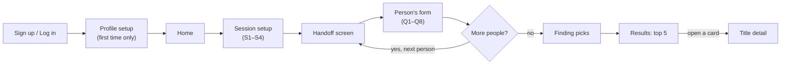

# Movie Recommender — UI/UX Spec

Last updated: 27 Sep 2026 · Related docs: [PRD](./prd.md) · [Forms Spec](./forms-spec.md) · [Wireframes](./wireframes.md) · [TRD](./trd.md) · [Database Schema](./database-schema.md) · [API Contracts](./api-contracts.md)

## Purpose & scope

This spec defines every v1 screen and flow of the group movie & series recommender in detail, and sketches v2–v6 roughly.

- **Platform:** desktop web app (React). Layouts use flexbox/grid with no fixed pixel widths, so the later PWA is a styling pass, not a rewrite.
- **Content:** movies and web series from any country; language is chosen in the form.
- **In v1:** email + password login with password reset, one-time host profile, "who's watching" setup, one form per person (the laptop is passed around), top 5 results + "show more", a detail view with the AI explanation.
- **Not in v1:** saved members, "We're watching this", watched history and Rewatch tag, 1–5 star ratings, AI mood text and chat, Google sign-in, where-to-watch and trailers, PWA. These are sketched in Later versions.

## Design principles

Five rules decide every screen; when two designs compete, pick the one that follows more of them.

1. **One laptop, many hands.** Each person's turn is clearly separate. A handoff screen hides the previous person's answers, so nobody copies or gets swayed.
2. **Fast to answer.** Target: under 60 seconds per person. Clickable chips and sliders, almost no typing.
3. **Fairness you can see.** Results show how each person is served, so the group trusts the pick.
4. **Every pick explained.** Each result carries a short AI reason; nothing appears "just because".
5. **Keyboard friendly.** Tab, Enter and arrow keys work everywhere, since a passed laptop often has no mouse.

## Theme options

Pick one of four directions; every color below becomes a CSS variable, so switching themes later means editing one file.

| Theme | Feel | Background / surface | Accent | Text | Fonts (heading / body) |
| --- | --- | --- | --- | --- | --- |
| A. Midnight Cinema | Dark theatre, marquee lights | #0E0F13 / #1A1C23 | #E5A00D gold | #F2F2F2 | Bebas Neue / Inter |
| B. Popcorn Pop | Bright, playful, snack-bar fun | #FFF8EE / #FFFFFF | #FF4D4D red + #FFC93C yellow | #1E1E1E | Fredoka / Nunito |
| C. Clean Studio | Light, minimal, professional | #FFFFFF / #F5F6F8 | #4F46E5 indigo | #111827 | Inter / Inter |
| D. Neon Night | Dark with glowing neon | #0B0B1A / #15152B | #7C3AED purple + #22D3EE cyan | #EDEDF5 | Space Grotesk / Inter |

Dark themes (A, D) make movie posters stand out, the way a dark cinema makes the screen glow. Light themes (B, C) feel friendlier for long forms.

**Chosen theme:** A. Midnight Cinema. Group size is 1 to 8 people.

## Information architecture

v1 has 9 screens in one straight path, with a loop that repeats the handoff and the form once per viewer.

Profile setup appears only on the first login. When watching alone, the loop runs once and skips Q1 and Q2. Results has a "Show more" button that loads 5 more on the same page. Home also links to Edit profile and Log out.

## Core user flows

Three flows cover all of v1; question codes (P, S, Q) refer to the [Forms Spec](./forms-spec.md).

**1. First sign-up**

1. Sign up with name, email and password.
2. Profile setup in 3 short steps: About you (name pre-filled, P2), Languages (P4, P5), Taste (P6, P7, P8, P9).
3. Land on Home.

**2. Watching alone**

1. Home: click "Find something to watch".
2. Session setup: S1, S2 = 1, S3, S4.
3. Person's form: Q3–Q8 only, pre-filled from the profile where possible.
4. Finding picks, then Results: top 5.
5. Open a card for Title detail.

**3. Watching as a group (2–8 people)**

1. Home: click "Find something to watch".
2. Session setup: S1, S2 = 2 to 8, S3, S4.
3. Handoff screen: "Pass the laptop to person 1". They click "I'm ready".
4. Person's form: Q1–Q8. On submit, answers are hidden.
5. Steps 3–4 repeat for each person (the host is one of them, with answers pre-filled).
6. Finding picks, then Results: top 5, showing how well each person is served.
7. Open a card for Title detail.

## v1 screens

Each screen lists its purpose, layout, elements, actions and states. All screens use the Midnight Cinema theme, content centred at a max width of 1200 px, and forms in a single 720 px column.

### 1. Sign up / Log in

- **Purpose:** get the host into an account in under a minute.
- **Layout:** split screen. Left: app name in Bebas Neue over a blurred poster collage. Right: a card with two tabs, Sign up and Log in.
- **Sign up fields:** name, email, password, confirm password.
- **Log in fields:** email, password, and a "Forgot password?" link.
- **Forgot password:** enter email → "Check your inbox" message (shown even if the email isn't registered, so nobody can test which emails have accounts) → link in the email opens a Set new password page → back to Log in. The link works once and expires after 30 minutes.
- **Validation:** valid email format; password at least 8 characters; passwords match. Errors show under the field in red, not as pop-ups.
- **States:** button shows a spinner while submitting; "Email already registered" links to the Log in tab; an expired reset link shows "This link has expired" with a button to send a new one.

### 2. Profile setup (first login only)

- **Purpose:** collect the one-time profile (P2–P9) so it is never asked again. The display name was already collected at sign-up, so it isn't asked again here — it just shows, pre-filled and editable, at the top of the first step.
- **Layout:** 3-step wizard with a progress bar: About you (name pre-filled, P2) → Languages (P4, P5) → Taste (P6, P7, P8, P9).
- **Elements:** chips for genres and languages; a search box with poster thumbnails for P8; a 3-step choice for P9.
- **Actions:** Back, Next, and Finish on the last step. Answers are kept when going Back.
- **Validation:** P2 and at least one language (P4) are required; P8 is shown but optional: add up to 5 titles, or leave it empty.
- **States:** P8 search shows "No matches" and a retry if TMDB is slow.

### 3. Home

- **Purpose:** one obvious next step.
- **Layout:** greeting ("Hi &lt;name&gt;"), one large gold button "Find something to watch", and a small profile summary card (languages, favourite genres) with an Edit link.
- **Top bar:** app name on the left; profile menu on the right with Edit profile and Log out.
- **States:** Edit profile reopens the 3-step wizard with current answers filled in.

### 4. Session setup

- **Purpose:** the four shared questions (S1–S4), answered once by the host.
- **Layout:** one page, four stacked blocks. S1 as three large cards (Movie, Series, Either); S2 as a stepper (− / number / +, limited to 1–8); S3 as chips that change with S1; S4 as optional chips.
- **Actions:** "Start" goes to the Handoff screen (group) or straight to the Person's form (alone). "Cancel" returns Home.
- **Validation:** S1, S2 and S3 required; the Start button stays disabled until they are set.

### 5. Handoff screen

- **Purpose:** a privacy wall between people, so nobody sees or copies someone else's answers.
- **Layout:** full-screen, dark, centred. Large text "Pass the laptop to person 2 of 4", a row of numbered dots showing who is done, and a gold "I'm ready" button.
- **Actions:** "I'm ready" (or Enter) opens the next form. A small "Go back" link reopens the previous person's form, kept on purpose so someone can fix a mistake.
- **Rule:** the host goes first, since their answers are pre-filled from the profile.

### 6. Person's form

- **Purpose:** collect tonight's answers from one person (Q1–Q8), in under 60 seconds.
- **Layout:** single scrolling page. Top bar: "Person 2 of 4" and a thin progress line. Questions stacked in order, each as a short label plus chips or a slider.
- **Elements:** Q2 as 5 age-band chips; Q3 limited to 2 chips; Q4 to 3 chips (extra clicks show "Pick up to 3"); Q7 as a 3-step slider set to Balanced; Q8 as a search box with a Skip link.
- **Validation:** Q1 (unique within the session), Q2, at least one Q3 mood and at least one Q6 language are required. Missing items get a red outline and the page scrolls to the first one.
- **Actions:** "Done" hides the answers and goes to the Handoff screen or, for the last person, to Finding picks.
- **Alone:** Q1 and Q2 are hidden; answers are pre-filled from the profile.
- **Keyboard:** Tab moves between questions, Space toggles a chip, Enter submits.

### 7. Finding picks

- **Purpose:** show progress while the backend filters, scores and asks Groq.
- **Layout:** centred message ("Matching 4 people's answers…"), a film-reel spinner. The backend waits for scoring and all 5 AI explanations before responding, so this screen holds until everything is ready, then hands off directly to Results with every card fully formed.
- **States:** after 10 seconds, add "Still working…". On a TMDB, Groq, or server error: "Couldn't reach the movie database" with Retry.
- **No results:** "Nothing fits everyone tonight", plus the filter that removed the most titles (for example "the 90-minute limit") and a button to loosen it.

### 8. Results: top 5

- **Purpose:** show 5 picks the whole group can live with, and why.
- **Header:** "Top 5 for Rahul, Priya, Sam + 1" and the session summary (Movie · 90–120 min).
- **Layout:** 5 poster cards in one row; below them "Show more" loads the next 5 as a second row.
- **Each card:** poster; title; year · runtime (or episodes) · certificate; a group match % in gold; one small circle per person with their initial, green at 70+ and amber at 40–69 (the misery rule means no one is below 40); a 2-line AI reason.
- **Badges:** "Compromise pick" when the misery threshold had to be lowered; "Not rated" when a title has neither an Indian nor a US certificate.
- **Actions:** click a card for Title detail; "Change answers" returns to Session setup with all answers kept; "Start over" clears the session.
- **States:** the backend waits for all 5 AI explanations before responding, so cards and their reasons appear together, fully formed; there is no partial or shimmering state on this screen.

### 9. Title detail

- **Purpose:** help the group decide on one title.
- **Layout:** wide backdrop image at the top, then poster on the left and details on the right.
- **Details:** title, year, certificate, runtime or seasons, genres, overview, top 5 cast with photos.
- **"Why this pick" block:** the full AI explanation, then one line per person ("Priya: matches Thrill and Hindi").
- **Actions:** "Back to results" (also Esc). Where-to-watch and trailers arrive in v6.

## Shared components and states

Every screen is built from the same few parts, so the app feels consistent and React components are reused.

| Component | Look (Midnight Cinema) | Behaviour |
| --- | --- | --- |
| Primary button | Gold #E5A00D fill, dark #0E0F13 text, 8 px corners | Hover brightens; disabled at 40% opacity; spinner while busy |
| Secondary button | Transparent, thin light border | Used for Back, Cancel, Change answers |
| Chip | Surface #1A1C23, thin border | Selected: gold border, gold text and a check mark; Space toggles |
| Text input | Surface fill, thin border | Focus: 2 px gold ring; error text in red #E5484D below |
| Title card | Surface fill, 12 px corners, 2:3 poster | Hover lifts slightly with a gold outline |
| Person circle | Initial letter in a circle | Green #3DD68C at 70+, amber #F5A524 at 40–69 |
| Progress | Thin gold line, or numbered dots on Handoff | Shows how many people are done |
| Loading | Shimmer blocks shaped like the content | Replaced in place, so the page does not jump |
| Message (empty or error) | Icon, one sentence, one button | Always offers a next step (Retry, Loosen filter) |

**Type:** screen titles in Bebas Neue (40 px, 32 px); everything else in Inter (16 px body, 14 px labels).

**Focus:** a visible 2 px gold focus ring on every clickable element, never hidden, because the passed laptop is often used without a mouse.

## Later versions (rough)

Each version adds a few screens or blocks on top of v1; details get designed when that version starts.

| Version | New or changed screens |
| --- | --- |
| v2 | Handoff asks "Who's this?": pick a saved member or add a new one. New Members page to edit or remove them (name, birth year). "We're watching this" button on Title detail. Watched history page. "Rewatch?" tag on result cards |
| v3 | Rating screen after watching: laptop passed around again, 1–5 stars per person. Home shows "How was &lt;title&gt;?" the next time the host logs in. Ratings shown in watched history |
| v4 | Free-text mood box on the Person's form ("something like Inception"). Chat panel beside Results to refine ("less scary"), which re-ranks the cards |
| v5 | "Continue with Google" button on Sign up / Log in |
| v6 | Where-to-watch logos and an embedded trailer on Title detail |
| PWA | Layouts adapted for phone widths, install prompt, app icon |
| Deployment | No new screens |

## Open questions

None right now. Decided on 27 Sep 2026: password reset is in v1, the Handoff "Go back" link stays, unrated titles show a "Not rated" badge, profile question P8 is optional, and the host always goes first in the handoff order.
